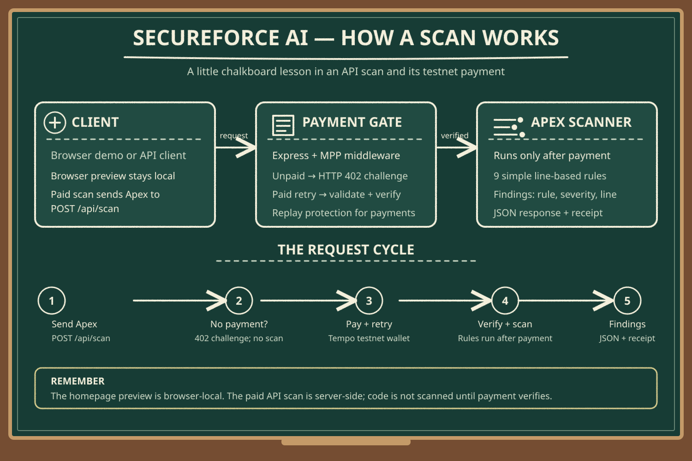

# SecureForce AI

**A pay-per-scan security scanner prototype for Salesforce Apex.** Each API scan costs **$0.08 in Tempo testnet tokens** through the Machine Payments Protocol (MPP). Testnet tokens are not real money.

The project has two ways to try the scanner:

- **Browser preview:** runs a small set of matching rules in your browser. The Apex you type stays in the browser.
- **Paid API scan:** sends Apex to the server and scans it only after an MPP payment has been verified.

## How it works



### The API scan, step by step

1. An MPP-compatible client sends `POST /api/scan` with Apex code.
2. Without payment credentials, the API responds with **HTTP 402** and a signed payment challenge describing the amount and payment details. The code is not scanned.
3. The client pays the challenge using a funded **Tempo testnet** wallet, then retries with the payment credential.
4. The server validates the paid request, verifies the payment, and prevents a transaction from being reused for another scan.
5. Only after payment succeeds, the server checks the Apex source with its prototype rules and returns JSON findings with a `Payment-Receipt` response header.

The payment log stores payment metadata only; it does not store submitted Apex code.

### What the scanner checks

The prototype evaluates nine simple, line-based patterns, including SOQL string concatenation, missing or unsafe sharing declarations, insecure HTTP callouts, possible hard-coded credentials, and CRUD/FLS concerns. It is a demonstration—not a complete Salesforce static analyzer. See [`server/src/scan.ts`](server/src/scan.ts) for the current rules.

## Try the browser demo

Start the app locally (see [Run locally](#run-locally)) and open [http://localhost:4200](http://localhost:4200).

- Choose an editable Apex sample and run **Preview** to see a browser-local pattern check. This does not call the API or upload your code.
- Use the payment-challenge action to see an unpaid API request return HTTP 402. That request does not scan or charge.
- A completed API scan requires an MPP-compatible client and a funded Tempo testnet wallet.

## API endpoints

| Endpoint | Purpose | Payment |
|---|---|---|
| `POST /api/scan` | Scan Apex code and return findings | $0.08 per successful scan |
| `GET /health` | Check service status | Free |
| `GET /openapi.json` | Discover the API and its payment challenge | Free |
| `GET /llms.txt` | Read machine-oriented usage instructions | Free |
| `GET /api/payments` | View recent verified payment metadata | Free |

### Scan request and response

Request body:

```json
{
  "code": "public without sharing class Demo { }"
}
```

The scan response includes a scan ID, timestamp, duration, rule summary, and findings. Each finding includes its rule ID, severity, line number, matching code, explanation, and suggested fix. A successful response also includes the MPP `Payment-Receipt` header.

## Run locally

**Requirements:** Node.js 20 or newer, npm, and an MPP-compatible client for paid scans.

Install dependencies and configure the required server environment:

```bash
npm install
export MPP_SECRET_KEY="$(openssl rand -hex 32)"
```

Create and fund a Tempo testnet wallet, then set the address that should receive payments:

```bash
npx mppx account create --network testnet
npx mppx account fund --network testnet
npx mppx account view
export TEMPO_RECIPIENT=0xYourAddressHere
```

Start the development server:

```bash
npm run dev
```

The app listens on [http://localhost:4200](http://localhost:4200) by default. `PORT` can be set to change the port. The server requires both `MPP_SECRET_KEY` and a valid `TEMPO_RECIPIENT` address.

### Test the API

An unpaid request should return HTTP 402 with a payment challenge:

```bash
curl -i -X POST http://localhost:4200/api/scan \
  -H 'content-type: application/json' \
  -d '{"code":"public class A {}"}'
```

An MPP-compatible CLI can pay the challenge and retry the request on testnet:

```bash
npx mppx http://localhost:4200/api/scan --network testnet \
  -J '{"code":"public without sharing class Demo { }"}'
```

Check the free service endpoints:

```bash
curl http://localhost:4200/health
curl http://localhost:4200/api/payments
npx mppx validate http://localhost:4200
```

## Deploy

Deploy to a host that runs Node.js (for example, Railway, Fly.io, or Render):

```bash
npm install
npm run build
npm start
```

Configure `MPP_SECRET_KEY`, `TEMPO_RECIPIENT`, and `MPP_REALM` for your deployed service. Keep the secret key private and use a testnet wallet for this prototype. Then validate the public URL:

```bash
npx mppx validate https://YOUR-URL
```

## Project layout

```text
server/src/index.ts   Express app, demo page, API routes, and MPP payment gate
server/src/scan.ts    Prototype Apex matching rules and findings
docs/architecture-board.svg
                      Chalkboard-style architecture and request flow
```

## Prototype limitations

- The scanner uses simple, line-based patterns; it is not full Apex static analysis. A production scanner could use Salesforce Code Analyzer and PMD.
- Payment replay protection uses an in-memory store and supports a single server process. Use a shared store such as PostgreSQL when scaling out.
- Payment metadata is held in memory and resets when the process restarts.
- A scan error after a payment succeeds is not automatically refunded.
- Browser preview rules are a small local demo subset; use the paid API for the server-side prototype scan.
